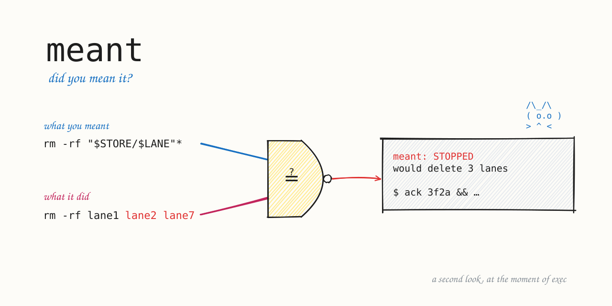

<p align="center"></p>

# meant

**Lightweight, cross-platform safety for agent shell commands.**

Sandboxes, allowlists and permission prompts are built for an adversary. They
ask *"is this command allowed?"* A mistaken agent passes that test every time:
the command is allowed, it just does not do what the agent thinks it does.

`meant` asks the other question: *is this what you meant?* It sits where the
harness runs shell commands and looks at what a command **actually does**,
after the shell has expanded every variable and glob: the real paths, the real
pids, the real remote. When that is probably not what the agent had in mind,
the agent sees it while it can still be stopped or taken back.

<p align="center"></p>

Every line above is what `meant` printed; [`docs/art/record.sh`](docs/art/record.sh)
records it again. No rule says "block `rm -rf`": the same command with `LANE=lane7`
runs with a one-line note. What stopped it is what it was about to do. To turn
the `LANE` knob yourself: [the playground](https://shuxueshuxue.github.io/meant/playground.html).

## What it looks like in a real session

This is Claude Code, unmodified, with `meant` attached, asked to clean up its
lane's artifacts with a project script (trimmed, and the store path shortened):

```console
> sed -i 's/a - b/a + b/' calc.py && python3 test_calc.py && LANE=lane7 ./cleanup.sh; ls $STORE
ok
meant: STOPPED. The command was cut off before this took effect:
  rm -rf /srv/store/lane7
    would delete 60 files in 1 dir (1.0 KB) under /srv/store/lane7
    ! it is outside your workspace and temp directories
  Everything before it in the command already ran; nothing after it did.
  Meant it? Run it again with `ack d71c` in front (`ack d71c && ...`). Did not? Fix the command.
meant: files ~1 (calc.py)

agent: The block is on the exact deletion you asked for, lane7's directory in the
       shared store. I set LANE=lane7 myself, so only that directory is in scope.

> ack d71c && LANE=lane7 ./cleanup.sh; ls $STORE
cleanup done
lane1  lane2  lane9
meant: went ahead as acknowledged: rm -rf /srv/store/lane7
```

Run the same script with `LANE` unset — the bug that script actually has — and
the message reads `would delete 240 files in 4 dirs under /srv/store: lane1,
lane2, lane7, lane9`. That one line is the difference between an agent that
says "done" and an agent that says "wait".

## Install

One static binary, no runtime, no daemon, no root.

```sh
go build -o meant ./cmd/meant        # or take a binary from dist/
meant install claude-code            # this project   (--user: every project)
meant install codex
meant doctor                         # exercises every observer and says what works here
meant remote add <host>              # observe what `ssh <host> ...` does over there
meant remote allow <host>            # or: let commands go there unobserved, without stopping
```

Any other harness: make it run `meant run -c '<command>'` instead of the
command. That is the whole integration; there is no protocol for a harness to
implement.

| Harness | How it attaches | Status |
|---|---|---|
| Claude Code | `CLAUDE_CODE_SHELL_PREFIX` + `SessionStart`/`Stop` hooks. Permission rules keep seeing the agent's original command. | run with live agents during development; transcripts above |
| Codex | `PreToolUse` hook rewrites the command (same hook protocol as Claude Code) | written against the documented protocol, **not yet run on a live Codex** |
| anything else | `meant run -c '...'` | — |

Code Mode (the agent writes JavaScript that calls tools) needs nothing extra
where the harness routes those calls through its normal tool layer, as Claude
Code does: every shell call the script makes arrives at `meant` like any other.

## The protocol, all of it

There are two words, and they are ordinary commands:

```sh
ack 7f3a && make deploy     # "I meant that."  Lets a stopped effect through, or accepts one that happened.
reject 91ab                 # "I did not."     Takes back an effect that happened.
```

The code is a hash of the effect itself — which action, on which concrete
targets. An agent can only produce it by having read the description, and it
is only good for that effect: if the targets change, so does the code.

A stop costs one extra shell call when the effect was meant: the agent reads
the report and runs the command again under the ack. Nothing asks for an ack
unless something surprising happened. That is the point. A confirmation the
agent gives a hundred times a day is a rubber stamp; one it gives once a week
still means something.

## How it works

A command is a **transaction**. Around it, a few **observers** report
**effects** in one small vocabulary. One **judge** decides which effects
deserve attention. A **ledger** remembers what is still unacknowledged.

```
 harness ──► meant run ─┬─ before:  snapshot the workspace
                        ├─ during:  the command runs untouched; meant's stand-ins sit
                        │           first on PATH at the few programs whose effects
                        │           cannot be taken back
                        └─ after:   what changed? what is still running? → judge → digest
```

Three observers, each good at what the others cannot see:

**Effect points.** `rm`, `chown`, `chmod`, `kill`, `pkill`, `find -delete`,
`git push`, `git commit` and a few more are stood in for on `PATH`. By the
time one of them is executed, the shell has finished every expansion — every
variable, glob, `$(...)`, `xargs`, trap, in whatever script the call was
buried in. The stand-in sees the real argv and asks the real system: how many
files is that, whose are they, is that a mount point, which process is pid
4242 and who started it. Ordinary answer: it `exec`s the real program and is
gone. Surprising answer: the command is stopped *there*, before the effect,
and the rest of the command — written on the premise that this step did what
the agent thought — does not run. No shell parsing happens anywhere.

**Workspace snapshots.** Before and after each command, a private git
repository (never your project's `.git`) records the working tree, at about
the cost of `git status`. That covers what no stand-in can name: scripts,
redirections, formatters, interpreters. The judge does not flag "files
changed". It flags **work destroyed**: content that was in no commit, stash or
branch and is now gone. `git reset --hard` over a clean tree is silent; over
four hours of uncommitted edits it comes back with a code, and `reject` puts
every file back. `meant undo` does the same for any recent command.

**Process census.** Every command runs in its own process group, and
everything it starts carries a marker in its environment. Between them they
survive `&`, `nohup`, `setsid` and double forks. So `meant` can tell which
processes are the agent's own (signal them freely) and which are not (the dev
server you started this morning), and it can say what a command left running.

### Across ssh

Agents that operate machines do much of their damage one hop away: in a week
of our own agents' sessions, 40% of shell calls went through `ssh`, and so did
71% of the calls that named `rm`, `kill`, `chmod` or a forced push
([`scripts/bash_census.py`](scripts/bash_census.py) counts your own).

```sh
meant remote add gpu          # copies the binary there once; nothing is installed on hosts you did not name
```

After that, `ssh gpu '<command>'` run by an agent is observed **on gpu**. The
local stand-in for `ssh` does not try to understand the remote command. It
joins the words exactly as ssh would, carries the result as one opaque,
once-quoted string, and asks the `meant` on the far side to run it in the
shell ssh would have used. Over there it is an ordinary transaction: that
machine's stand-ins see that machine's real arguments, files, owners and
processes.

```console
> ssh mac 'cd /srv/store/lane7 && rm -f -- obj*.bin && ls -A | wc -l'
meant@mac.local: STOPPED. The command was cut off before this took effect:
  rm -f -- obj1.bin obj10.bin obj11.bin ...
    would delete 60 files under /srv/store/lane7: obj1.bin, obj10.bin, obj11.bin, obj12.bin, … (+56)
    ! it is outside your workspace and temp directories
meant: STOPPED on mac; its report is just above. Nothing after `ssh mac ...` ran here either.

> ack 9518 && ssh mac 'cd /srv/store/lane7 && rm -f -- obj*.bin && ls -A | wc -l'
       0
meant@mac.local: went ahead as acknowledged: rm -f -- obj1.bin obj10.bin ...
```

(A real Claude Code session, Linux to macOS; path and host name shortened.) The report
comes back over ssh's own stderr. An ack given here travels with the command.
A stop over there stops the rest of the command here. A process the session
started there in one command is still its own in the next. A further `ssh`
from that host is followed again.

A command sent to a host that is neither added nor allowed stops, with both
choices in the report: `meant remote add <host>` to observe it there,
`meant remote allow <host>` to let commands go there unobserved from now on,
or `ack` for this one call. Silently passing would make every other rule end
at the first `ssh`; the stop asks once per host which kind of channel it is.

Not followed, and left exactly as they were: allowed hosts,
interactive logins, port forwards and control commands, and any ssh option
this parser does not know. `scp` and `rsync` are not followed at all. A remote
command that switches user through something other than `sudo` loses the
stand-ins from that point.

What the observers cannot see, they say: `ssh` to an allowed host is
reported as "ran on another machine; nothing it did there was observed", in
one line. Effects that land in a database or a cluster can be **declared** in a short
table (`drizzle-kit push`, `terraform destroy`, ...; add your own in
`.meant.json`). Declared effects are held for an ack and labelled as declared,
not observed.

### What counts as surprising

Never the name of the command. Three questions about the concrete effect:

- **Whose is it?** Inside the workspace and your temp dirs is yours. Other
  users' files, your real home directory, a filesystem root, a process this
  session did not start, are not.
- **How much is it?** Three files outside the workspace is a note. Three
  thousand is a question.
- **Who else does it reach?** A hard link changes the other path too. A device
  node is everyone's. A forced push replaces history for the whole team.

These are thresholds for attention, not walls. Everything can go ahead; the
agent just has to have seen it first.

## What it catches

Each row is a real report; `test/incidents.sh` replays its shape end to end
(46 checks, a few seconds; 11 of them go through `sshd` on localhost to stand in
for a second machine, and are skipped where there is none).

| What the agent believed | What the command did | Seen by |
|---|---|---|
| `$HOME` is still my temp dir ([claude-code#75859](https://github.com/anthropics/claude-code/issues/75859), [#93099](https://github.com/anthropics/claude-code/issues/93099)) | `rm -rf` of the real home | effect point: real path, anchored to the account's home, not `$HOME` |
| the trap deletes the temp dir it was set for ([#88462](https://github.com/anthropics/claude-code/issues/88462)) | variable reassigned before exit; trap deletes `$HOME` — inside a script the permission layer saw only as `bash test.sh` | effect point: fires at the actual `rm`, wherever it is |
| the glob matches my lane's files | root, sticky bit bypassed: every lane's files | effect point: owners of the real matches |
| `ps \| awk \| xargs kill` hits my node processes | the list included pid 1 | effect point + census |
| `pkill -f pattern` hits my server | it also matched every shell whose command line mentioned the pattern | effect point: what the pattern matches *now* |
| `chown -R` fixes my cache | the cache was hard-linked to a shared template: 1,769 files changed there | effect point: link counts |
| `chmod 644` on my files, plus a stray `/dev/null` | every non-root process on the host lost `/dev/null` | effect point: device node |
| "move this directory" → `git reset --hard` ([#7232](https://github.com/anthropics/claude-code/issues/7232)) | hours of uncommitted work gone | snapshot: work destroyed, `reject` restores |
| the push was rejected, so force it ([#33402](https://github.com/anthropics/claude-code/issues/33402)) | remote history replaced by one commit | effect point: asks git what the push would discard |
| `git add -A` resolved the conflicts | three files committed with `<<<<<<<` in them | guard at `git commit` / `rebase --continue` |
| `drizzle-kit push --force` syncs the schema ([#27063](https://github.com/anthropics/claude-code/issues/27063)) | 60 production tables dropped | declared effect |

While building this, the author made the `pkill -f`/`pgrep -f` mistake five
times, by accident: the pattern matched the shell running it. Four times the
shell died — three outside `meant`, one inside it through a bug since fixed
(bash's `command kill` still runs the builtin). The one time `meant` saw it,
it read `1 of 2 targets were not started by this session: 2463042 /bin/bash
-c ...` and stopped.

## What it does not do

- **It is not a sandbox.** A program that calls `unlink(2)` itself, or
  `/bin/rm` by absolute path, walks past the stand-ins. Inside the workspace
  the snapshot still sees the result and can restore it; outside, nothing
  does. That is the price of needing no privilege and working the same on
  three operating systems, and it is the right trade for an agent that is
  wrong rather than hostile. If you need to contain an adversary, run a
  sandbox — and run `meant` inside it, because a sandbox is perfectly happy
  to let an agent destroy everything it is allowed to touch.
- **Daemon-side and network effects are not observed**: `docker`, `kubectl`,
  HTTP APIs, `rsync --delete` on the far side. They are noted or declared,
  never pretended. `ssh` is followed only to hosts you have added; hosts you allowed run unobserved.
- **Git-ignored files are not snapshotted.** Deleting `node_modules` is free;
  so is deleting an ignored `.env`.
- **Nested login shells** (`bash -lc`) rebuild `PATH` and lose the stand-ins
  for what runs inside them.
- A stopped command has already run everything before the stopped step.

## Platforms

| | Effect points | Snapshots | Process ownership |
|---|---|---|---|
| Linux | yes | yes | process group + environment marker (`/proc`) |
| macOS | yes | yes | process group; marker only where macOS lets it be read (not for system binaries) |
| Windows (Git Bash) | external programs only (`rm.exe`, `git`, ...); `cmd` and PowerShell built-ins are not stood in for | yes | ancestry only |

Verified: Linux (bash) — unit tests, the incident suite, live Claude Code
sessions, and following ssh to a second host. macOS 26 on arm64 (zsh) — the
incident suite (34/34 before the ssh checks were added), and as the far side
of ssh from Linux, including a live agent session. Windows — it
cross-compiles and has **never been run**; treat that row as a design, not a
claim. DESIGN.md has the details, including the four macOS-only bugs the first
run there found.

## Configuration

Optional. `.meant.json` in the workspace, or `config.json` in the state
directory (`~/.local/state/meant`):

```json
{
  "zones": ["/srv/store/lane7"],
  "limits": { "outside_entries": 50, "lost_files": 3 },
  "declare": [
    { "cmd": "supabase", "args": ["^db$", "^reset$"], "says": "drops and recreates the linked database" },
    { "cmd": "gh", "args": ["^release$", "^delete$"], "says": "deletes a published release" }
  ]
}
```

`zones` are extra directories that count as the agent's own. `declare`
entries match the real argv of a program (each pattern must match some
argument, in order).

## For people

```sh
meant log        # what recent commands actually did
meant status     # effects no one has acknowledged
meant undo       # put the workspace back to before the last command that changed it
```

When an agent ends its turn with something unacknowledged, the `Stop` hook
sends it back once to resolve it and tell you; if it still does not, you get
the list.

## Cost

About 0.15 s per command on a 12,000-file repository (two snapshots), and
3–4 ms per stood-in program call. The first snapshot of a workspace hashes
every tracked file once. Commands that change nothing get no output at all.

## Design notes

[DESIGN.md](DESIGN.md) is the record of how this got its shape: what was
tried, what was cut, and why the cuts were right.

MIT licensed.
